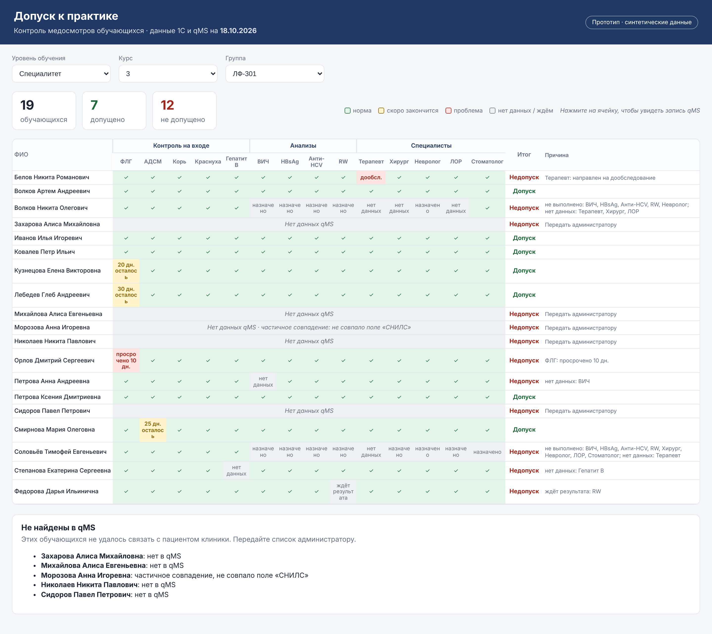

# Допуск к практике: прототип

Прототип функции контроля медосмотров обучающихся. Сервис сам берёт выгрузки 1С и qMS, связывает студентов с пациентами клиники, считает статус 14 обязательных обследований и итог допуска к практике, а методист видит результат по своей группе с объяснением причины.

**Закрывает требования:** FR-05 (итог «Допуск»), FR-06 (итог «Недопуск»), FR-03 («Нет данных qMS»), история US-1, вариант использования UC-01 «Проверить допуск группы к практике».

Все данные синтетические, люди вымышленные. Дата среза: 18.10.2026.



## Как запустить

Нужен Python 3.10 или новее (на Mac проверить: `python3 --version`).

```bash
./run.sh
```

Или двойной щелчок по файлу «Запустить прототип.command» в Finder. Скрипт сам создаст окружение, поставит библиотеки, загрузит данные, посчитает допуск и откроет http://127.0.0.1:8000. Остановить: Ctrl+C.

- Автотесты: `source .venv/bin/activate && python -m pytest -v`
- Список запросов сервера: http://127.0.0.1:8000/docs

Для демонстрации удобно открыть группу **Специалитет → 3 → ЛФ-301**: там 12 тестовых студентов со всеми сценариями.

## Как устроено

```
выгрузки 1С и qMS ──► 1. Загрузка ──► 2. Сопоставление ──► 4. Расчёт ──► витрина в SQLite ──► 5. Сервер ──► 6. Экран
                                                              ▲
                                     3. Справочник правил ────┘
```

| Часть | Файл | Что делает |
|---|---|---|
| 1. Загрузка | `app/loader.py` | Кладёт CSV из `data/source` в базу «как есть», одной транзакцией |
| 2. Сопоставление | `app/matching.py` | Связывает студента с пациентом по ФИО + дате рождения + СНИЛС; ищет частичные совпадения |
| 3. Правила | `app/rules.py`, `rules/*.csv` | Справочник: какие обследования обязательны, сроки, «плохие» заключения, нормальные ответы анализов |
| 4. Расчёт | `app/calc.py` | Статус каждого обследования, итог и причина; запоминает, на основании какой записи qMS |
| Сборка | `app/pipeline.py` | Запускает 1 → 3 → 2 → 4 (в реальной системе это ночное обновление) |
| 5. Сервер | `app/api.py` | Отдаёт экрану фильтры, таблицу группы, карточку ячейки |
| 6. Экран | `static/` | Фильтры, сводка, цветная таблица, карточка по клику, список несопоставленных |
| Тесты | `tests/` | 12 приёмочных сценариев + проверки логики и сервера (21 тест) |

**Правила меняются без программиста.** Например, чтобы сделать офтальмолога обязательным, достаточно добавить строку в `rules/exams.csv` и перезапустить: на экране появится 15-я колонка, и итог начнёт её учитывать.

## Работа с AI

Прототип сделан итерациями с AI-инструментом (Claude). Все запросы и результаты лежат в `docs/prompts/`:

| Запрос | Что было | Что изменилось |
|---|---|---|
| 1 | Постановка задачи, требования и ограничения | AI предложил структуру решения (6 частей, таблицы, справочник правил) и задал 4 вопроса |
| 2 | Ответы на вопросы | Первая версия: 17 тестов из 17, итог совпал с контрольным расчётом |
| 3 | Тестирование экрана: не видно причину, FR-03 не виден, порядок уровней, сдвиг даты | Галочки вместо «норма», объединённая ячейка «Нет данных qMS», порядок уровней, дата |
| 4 | Замер: таблица всё ещё шире экрана на 160 px | Перенос внутри ячеек, таблица помещается на 1440 px |
| 5 | Причина непонятна («Терапевт: не в норме») и слишком длинная | Причина из справочника, объединение однотипных статусов; найдено и убрано слово, зашитое в код; база собирается с нуля |
| 6 | Подпись «дообследование» вылезает из ячейки | Подпись сокращена в справочнике, добавлен перенос длинных слов |

Итог проверки: 21 тест из 21; сверка с независимым контрольным расчётом (`tools/check_data.py`) по всем 172 студентам и 14 обследованиям: 0 расхождений.

## Данные

Описание выгрузок, что добавлено к исходному набору и по каким правилам: `docs/data_README.md`. Пересобрать синтетику: `python3 tools/build_synthetic_data.py`.
